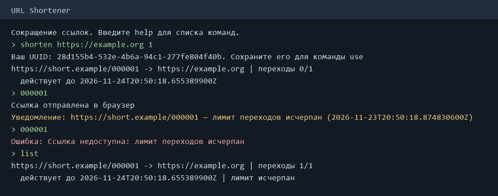
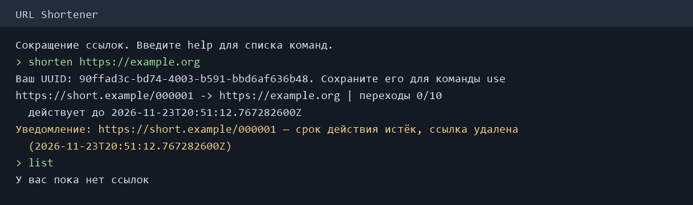

# Консольный сервис сокращения ссылок

Сервис создаёт короткие ссылки для HTTP(S)-адресов, открывает исходные страницы в системном браузере и отслеживает число переходов. Каждый пользователь управляет своими ссылками по UUID. Приложение удаляет ссылки по истечении заданного в конфигурации срока и показывает владельцу уведомления.

## Установка и запуск

Установите JDK 17 или новее и Apache Maven 3.9. Для открытия страниц нужен браузер по умолчанию и графический сеанс ОС. Maven загрузит JUnit и плагины сборки при первом запуске. Для запуска готового JAR достаточно Java.

```bash
git clone https://github.com/dimab5/java-lab-3.git
cd java-lab-3
mvn verify
java -jar target/url-shortener-1.0.0.jar
```

При необходимости передайте приложению путь к другому файлу настроек.

```bash
java -jar target/url-shortener-1.0.0.jar path/to/application.properties
```

## Работа с сервисом

1. Введите `shorten https://www.baeldung.com/java-9-http-client 3`. В чистом хранилище сервис вернёт `https://short.example/000001` и сгенерирует ваш UUID. Сохраните UUID для следующего запуска и держите его в секрете: он даёт доступ к управлению вашими ссылками.
2. Вставьте полученную ссылку или её код `000001` в консоль сервиса. Сервис передаст исходную страницу браузеру. Адреса `short.example` предназначены для ввода в CLI и разрешаются данными этого экземпляра сервиса.
3. После третьего перехода появится уведомление об исчерпании лимита. Четвёртый переход будет заблокирован. Команда `limit 000001 5` снова разрешит переходы, пока общий счётчик не достигнет пяти или не истечёт срок действия.
4. Для проверки другого пользователя выполните `new` и снова сократите тот же адрес. Сервис создаст новый UUID и выдаст другой код. Выполните `use <сохранённый UUID>`, чтобы вернуться в первый профиль. Эта же команда восстанавливает профиль после перезапуска.

| Команда | Действие |
| --- | --- |
| `shorten <URL> [лимит]` | Создать ссылку. Без аргумента лимита используется значение из настроек. |
| `<короткая ссылка или код>`, `open <ссылка>` | Открыть страницу. UUID для перехода не требуется. |
| `new` | Сбросить текущий профиль. Новый UUID появится при первом успешном сокращении. |
| `use <UUID>` | Выбрать ранее созданный профиль и получить его ожидающие уведомления. |
| `whoami` | Показать текущий UUID. |
| `list` | Показать свои ссылки, счётчики, лимиты и время истечения в UTC. |
| `limit <ссылка> <лимит>` | Изменить общий лимит своей ссылки. Минимум равен числу переходов или 1, если переходов ещё не было. |
| `url <ссылка> <URL>` | Изменить адрес назначения своей ссылки. Код, счётчик, лимит и срок действия сохраняются. |
| `delete <ссылка>` | Удалить свою ссылку. |
| `help`, `exit` | Показать справку или завершить сеанс. |

В аргументах `<ссылка>` можно использовать полный короткий адрес либо его код. Уведомления неактивных владельцев хранятся до следующего выбора их профиля. Переход учитывается при передаче URL операционной системе, поскольку CLI не получает результат загрузки страницы. Если Java сообщает об ошибке открытия браузера, приложение отменяет учёт перехода.

### Примеры работы

Приложение открывает ссылку один раз, сообщает об исчерпании лимита и блокирует повторный переход.



В отдельном запуске со сроком жизни `PT2S` приложение автоматически удаляет ссылку и уведомляет владельца. Команда `list` показывает, что ссылок больше нет.



## Конфигурация

Файл [application.properties](application.properties) читается при запуске. В его каталоге разрешаются относительные пути.

| Параметр | По умолчанию | Назначение |
| --- | --- | --- |
| `link.ttl` | `PT24H` | Срок жизни новых ссылок. Длительность ISO 8601, например `PT1H` или `PT24H`. |
| `link.default-click-limit` | `10` | Лимит, если пользователь его не указал. |
| `link.max-click-limit` | `1000000` | Верхняя граница задаваемого лимита. |
| `cleanup.interval` | `PT1S` | Интервал фоновой очистки, от 1 мс до TTL. |
| `storage.file` | `data/links.tsv` | Файл профилей, ссылок, счётчиков и уведомлений. |

Срок действия фиксируется при создании. Ссылка блокируется с момента истечения TTL, даже если очередная фоновая очистка ещё не прошла. Пока приложение закрыто, фоновой очистки нет. При следующем запуске сервис сразу удаляет истёкшие ссылки и записывает уведомления. Хранилище рассчитано на один процесс CLI, в котором можно переключаться между профилями.

## Структура проекта

- `core` содержит правила сокращения, проверки прав, учёта переходов, TTL и уведомлений. Код ссылки получается преобразованием сохранённого сквозного счётчика в Base62, поэтому удалённые коды не выдаются повторно в пределах одного хранилища.
- `infra` читает конфигурацию, атомарно сохраняет данные в локальный файл и открывает исходный URL через `Desktop.browse`.
- `ui` обрабатывает консольные команды, выводит ссылки, ошибки и уведомления активного профиля.
- `Main` связывает модули и запускает фоновую очистку.

## Тестирование

```bash
mvn test      # модульные и интеграционные тесты
mvn verify    # тесты, сборка JAR и проверка Checkstyle
```

Тесты проверяют уникальность кодов, права владельца, параллельные переходы, границы лимита, TTL в один час и сутки, уведомления, команды CLI и восстановление после перезапуска. В тестах используются управляемые часы, временные файлы и подменяемый вызов браузера. Для ручной проверки фоновой очистки запустите приложение с отдельным файлом настроек, задайте `link.ttl=PT5S`, `cleanup.interval=PT0.2S` и отдельный `storage.file`. Создайте ссылку и дождитесь уведомления в открытой консоли. После этого `list` покажет, что ссылка удалена.

GitHub Actions запускает `mvn verify` при каждом пуше и pull request. Настройки форматирования находятся в [.editorconfig](.editorconfig), правила линтера — в [checkstyle.xml](checkstyle.xml).
